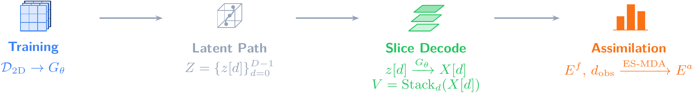
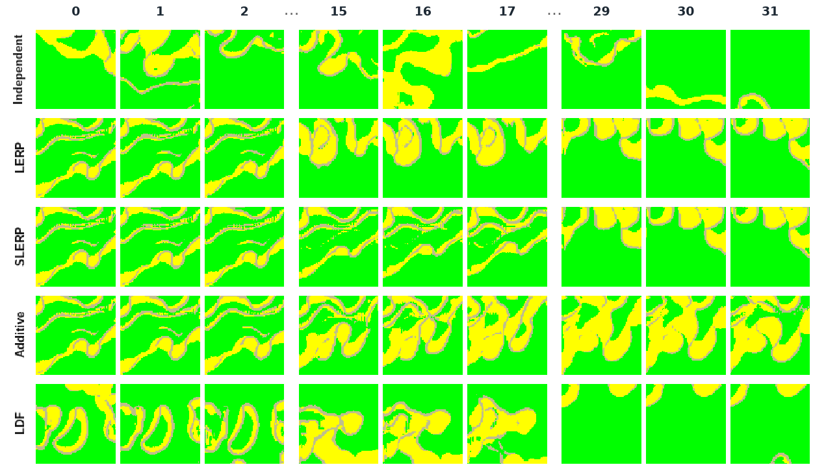
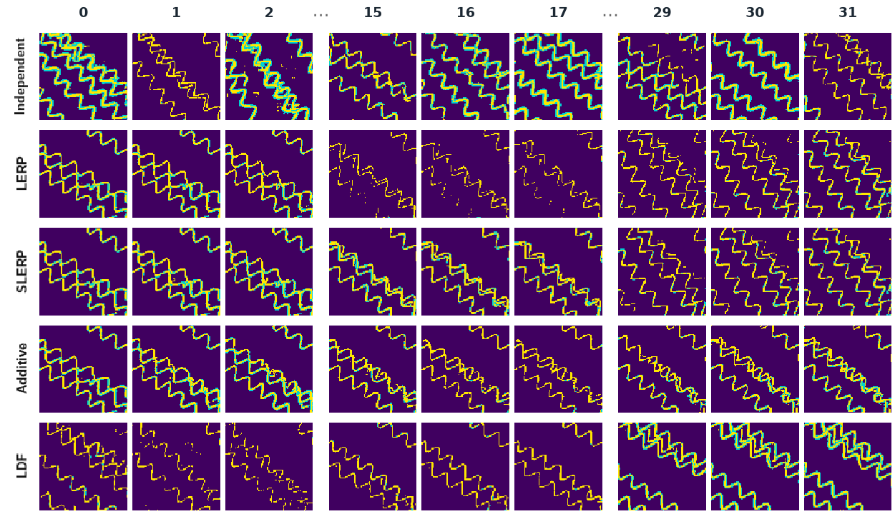

# Depth-dependent latent trajectories for 3D facies ensembles

Source code for the *Computers & Geosciences* manuscript:

> **Constructing 3D Facies Ensembles from 2D GANs through Depth-Dependent Latent Trajectories**

This repository implements a progressive unconditional 2D facies GAN, depth-dependent latent constructions for assembling 3D ensembles, and ES-MDA on the latent parameters.

<p align="center">
  
</p>

<p align="center">
  
  
  
</p>

**Contact:** Lucas Gomes Dantas — `lgd@academico.ufpb.br`

---

## Latent rules

Facies stacks under each construction (independent, LERP, SLERP, additive, LDF).

<table>
  <tr>
    <td align="center" valign="top" width="50%">
      <br/>
      <strong>GANRiver-I</strong>
      ·
      <a href="https://zenodo.org/records/7244958">Original data</a><br/>
      <sub>
        Sun, Demyanov &amp; Arnold (2023), <em>Data in Brief</em><br/>
        <a href="https://doi.org/10.1016/j.dib.2022.108785">Paper</a>
        ·
        <a href="./checkpoints/ganriver_i_s5_i460000.pt">Weights</a>
      </sub>
    </td>
    <td align="center" valign="top" width="50%">
      <br/>
      <strong>Petrel</strong>
      ·
      <a href="https://drive.google.com/drive/folders/1Z9xHuhkhXijOgxtGLFAhOX3yhPgfx-bd">Original data</a><br/>
      <sub>
        Di Federico &amp; Durlofsky (2025), <em>Mathematical Geosciences</em><br/>
        <a href="https://doi.org/10.1007/s11004-025-10245-x">Paper</a>
        ·
        <a href="./checkpoints/petrel_s5_i580000.pt">Weights</a>
      </sub>
    </td>
  </tr>
</table>

---

## Requirements

- Python 3.10 or later
- PyTorch 2.1 or later (CUDA recommended for training)
- Dependencies listed in `requirements.txt`

```bash
pip install -r requirements.txt
```

---

## Quick start

The commands below run a small synthetic example that exercises the full pipeline. They are intended for installation checks and are not the manuscript training configuration (`configs/train_paper.yml`).

```bash
# 1. Synthetic multi-scale HDF5
python scripts/make_example_h5.py --out data/example_scales.h5

# 2. Train (short progressive schedule)
python scripts/train.py -c configs/train_example.yml

# 3. Build a depth stack under a chosen latent rule
python scripts/build_volumes.py \
  --checkpoint runs/example/s0_i0000050.pt \
  --rule ldf --n 4 --depth 32 \
  --out outputs/volumes.npy

# 4. ES-MDA on latent parameters
python scripts/run_esmda.py \
  --checkpoint runs/example/s0_i0000050.pt \
  --reference outputs/ref.npy \
  --rule additive --n-ens 32 \
  --out outputs/esmda_run
```

Available latent rules: `independent`, `lerp`, `slerp`, `additive`, `ldf`.

---

## Training data format

Training uses a single HDF5 file with one dataset per progressive scale:

```text
facies_scales.h5
  attrs: n_classes, n_scales
  scale_0: (N, 4, 4)         # integer facies labels
  scale_1: (N, 8, 8)
  ...
  scale_5: (N, 128, 128)
```

Labels belong to `{0, …, n_classes − 1}`. Spatial size at scale `s` is `4 × 2^s` for the default latent spatial size `4 × 4`.

---

## Acknowledgements

The authors acknowledge the Federal University of Paraíba (UFPB), LTrace Geosciences, and Petróleo Brasileiro S.A. (Petrobras) for their institutional support during the development of this research.

---

## Citation

A formal citation will be added upon manuscript acceptance. Until then, please cite this repository, the GANSim publications of Song et al., and the dataset references under the figures above.

---

## License

MIT License. See [`LICENSE`](LICENSE).
